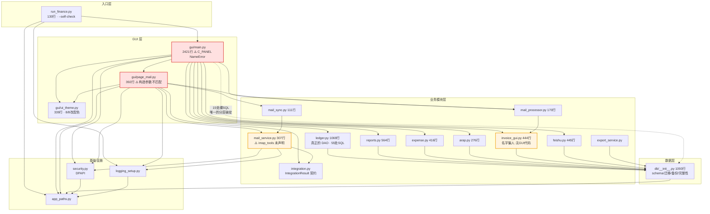
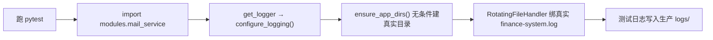

# 财务系统 架构评审报告

| 项 | 值 |
|---|---|
| 评审对象 | `C:\Users\li1\fin-system`（Python 3.11 + Tkinter + SQLite 单机财务系统） |
| 评审日期 | 2026-08-08 |
| 评审人 | 高见远（架构师） |
| 评审方式 | 只读静态分析 + 实际运行测试 + 生产库只读体检 |
| 代码规模 | 9,132 行 Python（22 个源文件） |
| 本次未修改任何业务代码 | 仅新增本报告 |

---

## 0. 一句话结论

**后端（账务内核 + 数据库 + 构建脚本）质量明显高于常见小微自研系统；但当前工作区的 GUI 处于「改坏了没修完」的状态——14 个页面里 13 个一打开就报错。生产上跑的那个 exe 是 7 月 11 日的旧版本，反而是好的。**

优先级只有一件事：**先把 GUI 修好并纳入 Git，再谈其它。**

---

## 1. 当前到底是什么状态

### 1.1 测试结果（实测）

`pytest` 在本机任何 Python 环境中**都没有安装**（`pyproject.toml` 里声明在 `[test]` extra 中，但从未安装）。我临时装到项目外目录跑完后已清理。

```
26 passed, 13 failed in 2.20s        (共 39 个用例)
```

| 测试文件 | 结果 | 说明 |
|---|---|---|
| `test_accounting_core.py` | ✅ 全通过 | 凭证状态机、幂等、不可变性、期间控制 —— **账务内核是可信的** |
| `test_reports_integrations.py` | ✅ 全通过 | 三大报表 + 集成 |
| `test_packaging.py` | ✅ 全通过 | 打包路径隔离 |
| `test_autostart.py` | ✅ 全通过 | 开机自启注册表 |
| `test_retry_page.py` | ✅ 全通过 | 失败发票重试 |
| `test_mail_service.py` | ❌ 9 个全失败 | `ModuleNotFoundError: imap_tools` |
| `test_mail_sync.py` | ❌ 4 个全失败 | 同上 |

**13 个失败全部是同一个根因**：`imap_tools` 这个第三方库被 `modules/mail_service.py:18` 顶层 import，但 `pyproject.toml` 里 `dependencies = []` —— **依赖从未声明、从未安装**。不是代码逻辑错，是依赖管理缺口。

### 1.2 语法检查

`python -m compileall` 全部通过，**8/8 凌晨的改动没有留下语法错误**。

### 1.3 但是：8/8 的改动留下了一个运行时致命错误

这是本次评审最重要的发现。

`gui/ui_theme.py:46` 在 8/8 的改版中把配色从深色改成了浅色（`C_CARD = "#ffffff"`），并留了一个兼容别名：

```python
# Back-compat alias used by legacy pages
C_PANEL = C_CARD
```

但 `gui/main.py:26-40` 的**显式 import 列表里没有把 `C_PANEL` 加进去**，而 `main.py` 里用了它 **57 次**。

实测证据：

```
>>> import gui.main as m; eval('C_PANEL', vars(m))
NameError: name 'C_PANEL' is not defined
```

**影响范围（13 个页面构建方法）**：

| 方法 | 对应界面 | C_PANEL 用量 |
|---|---|---|
| `_page_ledger` / `_build_voucher_editor` / `_build_voucher_browser` / `_build_trial_balance` / `_build_account_ledger` | **账务**（凭证录入/查询/试算/明细账） | 20 |
| `_page_cash` | **资金** | 2 |
| `_page_partners` | **往来** | 1 |
| `_page_expense_invoice` / `_build_expense_tab` / `_build_invoice_tab` / `_build_retry_tab` | **费用票据**（报销/发票/重试） | 16 |
| `_page_reports` | **报表** | 1 |
| `_page_settings` | **设置** | 14 |
| `_show_page_error` | 错误面板本身 | 3 |

`_show_page` 有 `try/except` 兜底（`gui/main.py:453-456`），所以程序不会崩溃退出，而是每个页面显示「页面载入失败」。**唯一还能用的是「工作台」和「邮件收票」两个入口**——而「邮件收票」有它自己的崩溃（见 §4）。

> 更糟的是：`_show_page_error` 自己也用了 `C_PANEL`，所以连错误提示面板都会二次抛错。

**修复：1 行**——在 `gui/main.py` 的 `from gui.ui_theme import (...)` 列表里加上 `C_PANEL`。

### 1.4 生产数据库健康（只读体检，未做任何写入）

```
journal_mode : wal          user_version : 4 (= SCHEMA_VERSION，已是最新)
integrity_check : ok        foreign_key_check : clean
synchronous : 2 (FULL)      ← SQLite 默认即 FULL，耐久性没问题
```

| 表 | 行数 | | 表 | 行数 |
|---|---|---|---|---|
| voucher | 13（posted 11 / draft 1 / pending_review 1） | | expense | 4 |
| voucher_line | 26 | | invoice_doc | 4 |
| account | 46 | | audit_event | 33 |
| data_issue | 3（**全部已 resolved**） | | cash_doc / arap_item / period | 0 |

**不平衡凭证：0 条。数据是干净的。** 这套系统真实承载的业务量目前很小（13 张凭证 / 208KB），这一点对后面的「不要做什么」很关键。

### 1.5 生产 exe 与源码严重脱节

| 物件 | 时间 | 含义 |
|---|---|---|
| `release/财务系统/财务系统.exe` | **2026-07-11 21:52** | 桌面快捷方式指向的、俊哥每天在用的版本 |
| 邮件/OCR 模块首次提交 | 2026-08-06 | 比 exe 晚 **26 天** |
| `财务系统.spec` 最后修改 | 2026-08-06 12:55 | 加了 `imap_tools`/`pystray` 隐藏导入 |
| `gui/main.py` 最后修改 | 2026-08-08 02:44 | 本次坏掉的改动 |
| 上次实际构建产物 `build/财务系统/Analysis-00.toc` | 2026-07-12 02:37 | 其中 **不含** `imap_tools`/`pystray` |

**结论：俊哥每天在用的 exe 完全不包含邮件收票功能，也不包含 8/8 那次坏掉的改动。生产是安全的；坏的只是工作区。** 这是个好消息，也意味着**现在还有从容修复的时间窗**。

---

## 2. 分层与依赖（实测，非臆测）

我用 AST 扫描了全部 22 个源文件的 import 关系。

### 2.1 实际依赖图



### 2.2 核心结论：分层是干净的，团队的三个猜测中两个不成立

| 检查项 | 结果 |
|---|---|
| 循环依赖 | **0 个** |
| 反向（下层→上层）依赖 | **0 个** |
| 层次顺序 | `entry → gui → modules → db → infra` 严格成立 |

**需要纠正的两个先入判断：**

| 原猜测 | 实测 | 说明 |
|---|---|---|
| ❌「`db/__init__.py` 把全部数据访问塞进包初始化文件」 | **不成立** | 它是 schema 定义 + 4 个迁移 + 备份 + 完整性检查 + 数据问题工作流，**没有一个业务 CRUD**。真正的 DAO 是 `modules/ledger.py`（55 处 SQL）。1093 行内容高度内聚，只是不该放在 `__init__.py` 里（应为 `db/schema.py`）。这是**包装问题，不是上帝类问题**。 |
| ❌「`modules/invoice_gui.py` 把 GUI 混进业务层」 | **不成立** | 该文件 **零 tkinter 引用**（`grep -l tkinter modules/*.py` 结果为空）。它是纯服务模块：发票入库、去重、哈希、转凭证。**只是名字是历史遗留的误导**。 |
| ✅「新老模块风格不一致」 | **成立** | 7 月模块（ledger/reports/expense）英文 docstring、类型标注完整、返回 `(bool, str)` 元组；8 月模块（mail_*）中文 docstring、返回 `IntegrationResult`、大量函数内 `import`、异常处理更松散。 |

### 2.3 唯一真实的分层破绽

`gui/main.py` 里有 **15 处直接 `conn.execute(...)` 裸 SQL**，绕过了 modules 层直接查库（包括 `PRAGMA integrity_check`、`PRAGMA table_info`）。这与它自己的文件 docstring 自相矛盾：

> "The GUI deliberately owns no accounting state transitions."

写操作确实都走了服务层（这点做到了），但**读模型查询直接打 DB**。属于可接受的务实妥协，不必现在动（见 §5）。

---

## 3. 真实技术债 TOP 5（按对业务的实际风险排序）

### 🔴 TD-1：GUI 当前是坏的（C_PANEL NameError）

| 项 | 内容 |
|---|---|
| **位置** | `gui/main.py:26-40`（import 列表缺失） vs 57 处使用；`gui/ui_theme.py:46` 定义了别名 |
| **后果** | 账务、资金、往来、费用票据、报表、设置 **6 大功能页全部显示「页面载入失败」**。只剩工作台可用。等于系统从源码运行时不可用。 |
| **为什么排第一** | 这是**现在就坏的**，不是潜在风险。而且极易误判为「系统烂了」而推倒重来。 |
| **工作量** | **S**（1 行：import 列表加 `C_PANEL`）。建议顺手把 `gui/main.py:25` 和 `:41` 的**重复 import**（`from modules import arap, expense as expense_mod, feishu, invoice_gui, ledger, reports` 出现了两次）删掉一行。 |
| **验证** | 改完后启动，逐个点击 6 个导航项确认无「页面载入失败」。 |

### 🔴 TD-2：没有版本控制

| 项 | 内容 |
|---|---|
| **位置** | 项目根目录**无 `.git`**（有 `.gitignore` 但从未 `git init`） |
| **后果** | TD-1 就是活生生的例子：8/8 凌晨改了 3 个文件，**无法 diff、无法回滚、无法知道改了什么**。我只能靠 AST 分析反推。下一次改坏一个金额计算逻辑，后果是账做错。 |
| **为什么排第二** | 它是**其它所有问题的放大器**。有 Git，TD-1 五分钟 `git diff` 就定位了。 |
| **工作量** | **S**（10 分钟）。`git init` → 确认 `.gitignore` 已排除 `db/*.db`、`config/feishu.json`、`build/`、`dist/`、`release/` → 首次提交打 tag `v20260711-shipped`（对应线上 exe），再提交当前工作区为 `wip-20260808`。 |

### 🟠 TD-3：构建流水线已经断了，下次打包会卡死

| 项 | 内容 |
|---|---|
| **位置** | `财务系统.spec:6` `Analysis(['gui/main.py'])` + `build.ps1:236-250` 步骤 [3/6] |
| **问题 A** | spec 的入口是 `gui/main.py`，但 `gui/main.py` **没有任何 argparse / sys.argv 处理**。`build.ps1` 第 3 步执行 `财务系统.exe --self-check --self-check-report ...` 并 `Start-Process -Wait`。冻结后的 exe 会**忽略参数直接弹出 Tk 窗口**，`-Wait` 永远等不到退出 → **构建脚本无限挂起**。 |
| **问题 B** | spec 的 `hiddenimports` 含 `imap_tools`、`pystray`，但 `pyproject.toml` `dependencies = []`，`build.ps1:196-203` 的隔离 venv **只装 `[build]` extra**（PyInstaller 那几个）。PyInstaller 对找不到的 hiddenimport 只发 WARNING 不报错 → **即使绕过问题 A，产出的 exe 也缺库**。 |
| **问题 C** | `run_finance.py:53-62` 的 `self_check()` 的 `required_modules` **不包含任何 mail 模块**（`mail_service`/`mail_sync`/`mail_processor`/`page_mail`）→ 自检对整个邮件功能是**盲的**。 |
| **后果** | 俊哥想发新版本时，`build.ps1` 会卡住；强行绕过则发出一个点开邮件页就崩的 exe。**当前无法安全发布任何更新。** |
| **工作量** | **M**（半天）。①spec 入口改回 `run_finance.py`（它才有 argparse，且带 `configure_logging()` + `ensure_app_dirs()` + 崩溃兜底 messagebox——现在这三样在打包版里全丢了）；②`pyproject.toml` 补 `dependencies = ["imap_tools==x.y.z"]`，`build.ps1` 增加安装运行时依赖；③`self_check` 的 `required_modules` 补齐 mail 模块。 |

> 附带说明：`build.ps1` 本身写得**相当好**——隔离 venv、`SOURCE_DATE_EPOCH` 可复现构建、冻结自检、密钥泄漏字节级扫描、SHA256 清单、原子发布带回滚、快捷方式原子替换。**不要重写它，只要修上面三处即可。**

### 🟠 TD-4：数据库没有自动备份

| 项 | 内容 |
|---|---|
| **位置** | `db/__init__.py:826 backup_database()` —— 全代码库**没有任何定时/自动调用点**；唯一调用来自 `gui/main.py:1968` 的 `getattr` 手动按钮 |
| **实际状态** | `%LOCALAPPDATA%\FinanceSystem\backups\` 有 4 个 .db，最新一个是 **2026-08-06 12:52**，且都是**迁移前自动备份或手工备份**，不是周期性的 |
| **后果** | 迁移前会自动备份（`init_db:763-775` 做得很好），但 **schema 已经稳定在 v4，不会再触发迁移 → 实际上等于再也不会自动备份了**。日常记账数据全靠俊哥记得手动点按钮。硬盘故障 = 从 8/6 之后的账全丢。 |
| **为什么不排更前** | 目前数据量小（13 张凭证），且 `finance.db` 与程序分离、`integrity_check` 干净、有 WAL。风险是「未来的」不是「现在的」。 |
| **工作量** | **S~M**（2 小时）。在 `FinanceApp.__init__` 里加一句：启动时若当日无备份则调 `backup_database()`，并保留最近 N 份（滚动删除）。已有函数带 `integrity_check` 验证，直接复用即可。 |

### 🟡 TD-5：邮件收票功能是半成品，且有静默丢票风险

这是 8 月新增功能，**从未真正跑通过**。四个独立缺陷：

| # | 缺陷 | 位置 | 后果 |
|---|---|---|---|
| a | **构造函数参数不匹配** | `gui/page_mail.py:187` 传 2 个位置参数 `MailSyncEngine(self._config_provider, self._update_box)`；`modules/mail_sync.py:23` 签名是 `(config_provider, poll_interval_minutes=30)` → `self._update_box * 60` → 实测 `TypeError: unsupported operand type(s) for *: 'method' and 'int'`。且该调用**在 try 块之外** | 点开「邮件收票」页直接 `TypeError` |
| b | **附件被静默丢弃，但水位线照常前进** | `mail_sync.py:53-69` 后台 `_run_once()` 只 `LOG.info("获取 %d 个附件")` 就结束，**从不调用 `process_attachment`**；而 `mail_service.py:224-226` 无论有无附件都推进 `config.last_uid`，`_persist_last_uid` 还会把它存盘 | **后台轮询会把发票邮件的 UID 水位线推过去，附件扔掉。这些票之后再也不会被收取。**（`process_attachment` 在 `page_mail.py:14` 被 import 但**全项目无任何调用点**） |
| c | **明文密码将写入磁盘** | `page_mail.py:385-386`：`set_secret(...)` 存 DPAPI 后又 `data["password"] = pwd  # 保留用于 _cfg 回退` → `MailBoxConfig.to_dict()`（`mail_service.py:117`）包含 `"password"` → `_save_configs()` 明文写入 `%LOCALAPPDATA%\FinanceSystem\config\settings.json` | **绕开了整条 DPAPI 链路。**目前 `settings.json` 的 `mail_boxes` 为空数组，**尚未真实泄漏**——但配置第一个邮箱的瞬间就会 |
| d | **SMTP 发信必然抛异常** | `mail_service.py:263` 用**未净化**的 `config.username` 拼密钥名；`security.py:29` 的 `_NAME_RE` 不允许 `@`。实测 `get_secret("mail_box.password.username@example.com")` → `ValueError`，且 `send_mail` 未捕获 | 任何真实邮箱地址发信直接抛 `ValueError`（收件侧 `fetch_attachments:172` 用的是净化后的名字，两边不一致） |

| 项 | 内容 |
|---|---|
| **工作量** | **M~L**（1~2 天）。建议**不要一次性修完**，见 §5 的处置建议。 |

---

## 4. 安全与数据可靠性专项

### 4.1 DPAPI 密钥链路：实现本身可信，但被上层绕过了

**`security.py` 的实现质量很高**，逐条核对：

| 检查点 | 结论 |
|---|---|
| 是否有明文落盘 fallback | ✅ 无。非 Windows / 测试模式一律走**进程内存**，且 `_protect` 显式 `raise SecretStoreError` |
| DPAPI 调用正确性 | ✅ 用了 `CryptProtectData` + 自定义 entropy (`_ENTROPY`) + `CRYPTPROTECT_UI_FORBIDDEN`；`LocalFree` 正确释放；buffer 生命周期有保护 |
| 落盘原子性 | ✅ `_write_store` 用 `mkstemp` + `flush` + `os.fsync` + `os.replace` |
| 密钥名注入防护 | ✅ `_NAME_RE` 白名单校验 |
| CLI 是否会打印密钥 | ✅ `_cli()` 明确注释 "Deliberately never print the secret itself" |
| 日志脱敏 | ✅ `logging_setup.py` 有脱敏处理 |
| 构建产物泄漏扫描 | ✅ `build.ps1:86-119` 逐字节扫描 UTF8+UTF16 两种编码的活密钥，并禁止 `finance.db`/`feishu.json`/`credentials.json`/`.env` 进入发布包 |

**唯一的泄漏点在调用方，不在 `security.py`：**

```mermaid
graph LR
    U["用户输入密码"] --> D["MailBoxEditDialog._on_save<br/>page_mail.py:380"]
    D -->|"set_secret()"| DP["✅ credentials.json<br/>DPAPI 加密"]
    D -->|'data["password"] = pwd<br/>page_mail.py:386'| C["MailBoxConfig.password"]
    C -->|"to_dict()<br/>mail_service.py:117"| S["❌ settings.json<br/>明文！"]

    classDef bad fill:#ffe0e0,stroke:#d33,stroke-width:2px
    classDef good fill:#e0ffe0,stroke:#3a3,stroke-width:2px
    class S bad
    class DP good
```

**当前状态：潜在未发生。** 实测 `settings.json` 的 `mail_boxes: []` 为空，磁盘上**没有**明文密码。修复只需删掉 `page_mail.py:386` 一行，并从 `to_dict()` 中移除 `password` 字段。

**另一个隐患**：`security.py:47` `_memory_backend()` 在 `FINANCE_SYSTEM_TEST_MODE=1` 时静默降级为纯内存存储。如果这个环境变量意外出现在生产环境，`set_secret()` 会**静默成功但不落盘**——不是泄漏，是「配了密码重启就没了」的诡异故障。建议在非冻结环境才允许该开关。

### 4.2 finance.db 备份机制：**存在但从不自动触发**

| 检查项 | 结论 |
|---|---|
| `backups/` 目录是否真在写 | ⚠️ 在写，但只在**迁移前**（`init_db:763-775`）和**手动点按钮**时 |
| 备份实现质量 | ✅ 很好。用 `sqlite3` 原生 `source.backup(destination)` 在线热备（非文件拷贝，WAL 安全），备份后立即 `quick_check` + `integrity_check` 验证，失败自动 `unlink` 不留半成品 |
| 迁移前保护 | ✅ 迁移前先 `quick_check`，不通过直接拒绝迁移；每个迁移独立 `BEGIN IMMEDIATE` + 失败 `rollback` |
| **周期性备份** | ❌ **没有**。schema 已到 v4（最新），迁移分支不会再触发 |
| 最近一次备份 | 2026-08-06 12:52（`finance-20260806-125237-132587.db`，208KB） |

**判断：备份的「能力」是完备的，缺的只是「触发器」。** 这是 §3 TD-4，S 级工作量。

### 4.3 SQLite 事务与并发：**没有实质隐患**

这一项的担心可以放下，逐条核对：

| 检查点 | 结论 |
|---|---|
| `journal_mode` | ✅ 实测生产库为 **WAL**（持久化在文件头，每次连接自动生效）→ 读写不互斥 |
| `synchronous` | ✅ 实测为 **2 (FULL)**。`get_conn()` 虽未显式设置，但 SQLite 编译期默认即 FULL，耐久性没问题 |
| 忙等超时 | ✅ `get_conn()` 双保险：`timeout=30.0` + `PRAGMA busy_timeout = 30000` |
| 外键约束 | ✅ 每条连接 `PRAGMA foreign_keys = ON` |
| 事务边界 | ✅ `transaction()` 用 `BEGIN IMMEDIATE`（写锁前置，避免升级死锁），异常必 `rollback` |
| 跨线程连接复用 | ✅ **不存在**。`get_conn()` 每次新建连接，后台线程（`gui/main.py:1381/1417`）各自持有独立连接，符合 sqlite3 `check_same_thread` 要求 |
| **后台收邮件线程是否写库** | ✅ **完全不写。** `MailSyncEngine._run_once()` 只做 IMAP 收取和 `last_uid` 存 **JSON 文件**，不碰 SQLite。所谓「定时线程 + GUI 主线程同时写库」的场景**实际不存在** |
| 真正的并发写场景 | `_fetch_invoices` / `retry_selected` 两个 worker 线程会调 `register_invoice` 写库。WAL 下单写者 + 30s busy_timeout，单用户场景**足够安全** |

**唯一的小瑕疵**（不值得现在修）：`mail_sync.py:51` 的 `time.sleep(self._poll_interval)` 在循环末尾，`stop()` 后最多要等一个轮询周期（默认 30 分钟）才真正退出。因为是 `daemon=True` 线程，进程退出时会被强制回收，**不影响用户**。

### 4.4 账务内核的数据完整性：**这是本项目最亮的部分**

`db/__init__.py` 的迁移 4 建立了一套**数据库级**（而非应用级）的会计管控，即使有人直接用 SQLite 工具改库也绕不过：

| 机制 | 实现 |
|---|---|
| 审计日志只追加 | `audit_event_no_update` / `audit_event_no_delete` 触发器 |
| 已记账凭证不可变 | `posted_voucher_no_update/delete` + `posted_line_no_insert/update/delete`，需线程局部 `_posted_mutation_allowed()` 才能豁免 |
| 状态机强约束 | `voucher_status_transition` 只允许 `draft→pending_review→audited→posted` |
| 记账前置校验 | `voucher_posting_guard`：分录≥2、借方>0、**借贷必平**、无 `UNRESOLVED` 科目、期间未关闭 |
| 已关账期间锁定 | `voucher_closed_period_insert/update` |
| 分录合法性 | 科目必须存在且为末级、借贷不能同时为正/零 |
| 金额精度 | 整数**分**（`debit_cents`）为准，REAL 列仅作历史兼容 → 无浮点误差 |
| 幂等性 | 7 个 `idempotency_key` 唯一索引 + 发票 `file_hash` / `(invoice_no, seller_tax_no)` 去重 |
| 历史脏数据 | 迁移 3 不静默修改：转为 `UNRESOLVED` 科目 + 写 `data_issue` + 写审计，**强制人工确认**（`resolve_data_issue`），且有阻断性问题时报表暂停 |

**这套设计的水准超出一般小微自研系统。不要动它。**

---

### 4.5 测试隔离缺陷：跑测试会写入生产目录（回应原第 3 问）

这是评审初稿漏答的原第 3 个问题——根因链与铁证均已实测坐实。**结论：测试隔离有漏洞，但账套数据本身安全；真正的问题是「没有任何护栏」。**

#### 4.5.1 根因链

1. `tests/` 下**没有任何 `conftest.py`**（`find . -name conftest.py` 全空）。
2. `app_paths.py:45-56` 的 `APP_DATA_ROOT` / `LOG_DIR` 是**模块导入时求值的模块级常量**；`logging_setup.py:10` `from app_paths import LOG_DIR` 拿到的是导入瞬间固化值。因此 `FINANCE_SYSTEM_HOME` 必须在 import 之前设置才有效——**等测试里再 setenv 已经晚了**。
3. `FINANCE_SYSTEM_HOME` 只在 `test_reports_integrations.py`(L12,L154) 和 `test_packaging.py`(L18,L69,L127) 里设置；`test_mail_service.py` / `test_mail_sync.py` / `test_accounting_core.py` / `test_autostart.py` / `test_retry_page.py` **五个文件完全没设**。
4. `modules/mail_service.py:24` `from logging_setup import get_logger` → `:26` `LOG = get_logger("modules.mail")` → `configure_logging()` **无条件调用 `ensure_app_dirs()`** 并把 `RotatingFileHandler` 绑到真实 `%LOCALAPPDATA%\FinanceSystem\logs`。**import 即污染**。



#### 4.5.2 铁证（指纹匹配）

生产日志 `%LOCALAPPDATA%\FinanceSystem\logs\finance-system.log` 中反复出现：

```
2026-08-06 13:09  WARNING finance_system.modules.mail  subject_regex 语法错误: [invalid(
...（共 15 条，时间跨度 8/6 13:09 ~ 8/8 02:44）
2026-08-08 02:44  WARNING finance_system.modules.mail  subject_regex 语法错误: [invalid(
```

这正是 `tests/test_mail_service.py:53` 的断言：

```python
assert _match_subject_regex("anything", r"[invalid(") is True
```

触发的指纹——`mail_service.py:_match_subject_regex` 在 `re.error` 时执行 `LOG.warning("subject_regex 语法错误: %s", pattern)`。该测试文件**没有**设置 `FINANCE_SYSTEM_HOME`，于是这条 WARNING 被写进了**生产日志**而非临时目录。痕迹时间窗（8/6 邮件模块首提交 ~ 8/8 02:44 末次编辑）与开发期完全吻合。

> 注：当前 `imap_tools` 未安装，该测试在收集阶段即 `ModuleNotFoundError`，所以**此刻**跑不会触发；但只要补齐依赖（见 ④）让用例真正运行，污染就会复现——这正是要先把护栏立起来的原因。

#### 4.5.3 影响边界（避免过度恐慌）

| 边界 | 状态 | 说明 |
|---|---|---|
| ✅ 账套数据安全 | **安全** | `test_accounting_core.py:24-32` 用 `db.configure_db_path(tmp)` + setUp/tearDown 成对切换到临时库，真实 `finance.db` **不会被测试写**。已核对。 |
| ⚠️ 实际污染范围 | **已发生** | 生产 `logs/` 被写入测试日志；`ensure_app_dirs()` 在真实数据根创建了目录结构。 |
| 🔴 真正的隐患 | **无兜底** | 全项目**没有 conftest.py**。一旦将来某个新测试忘了 `configure_db_path`，会**直接打真实账套库**，而没有任何一层拦得住。属于「今天没出事，但护栏根本不存在」。 |

#### 4.5.4 最小修复建议

新增 `tests/conftest.py`，在**任何项目模块 import 之前**（conftest 顶部、模块级）设置隔离根，并加一个 autouse fixture 兜底拦截越界写库：

```python
# tests/conftest.py —— 必须位于文件最顶部，任何项目 import 之前
import os
from pathlib import Path

_ISOLATED_HOME = Path(__file__).resolve().parent / ".test_home"
_ISOLATED_HOME.mkdir(parents=True, exist_ok=True)
os.environ.setdefault("FINANCE_SYSTEM_HOME", str(_ISOLATED_HOME))

import pytest
import db  # 此时 DB_PATH 已指向隔离根

@pytest.fixture(autouse=True)
def _guard_real_db():
    """任何测试想写真实账套库就直接 fail。"""
    real = Path(os.environ.get("LOCALAPPDATA", "")) / "FinanceSystem"
    assert not str(db.DB_PATH).startswith(str(real)), (
        f"测试试图写入真实账套库: {db.DB_PATH}"
    )
    yield
```

| 项 | 内容 |
|---|---|
| 原理 | `conftest.py` 由 pytest 在收集测试模块**之前**导入；顶部设 `FINANCE_SYSTEM_HOME` 后，`app_paths` 的模块级常量在首次 import 时就指向隔离根；autouse fixture 兜底拦截任何越界写库 |
| 工作量 | **S**（约 10 分钟） |
| 不要做什么 | 不要给每个测试单独 `setenv`——那是当前只有两个文件各自为政、其余五个漏设的根源；统一交给 conftest |

---

## 5. 不要做的事（避免过度工程）

俊哥的系统是**单用户、单机、日均个位数凭证**的场景。以下这些「看起来该重构」的地方，现在动 = 纯亏。

| # | 看起来该做 | 为什么现在不该做 |
|---|---|---|
| 1 | **拆分 `gui/main.py`（2421 行）** | 单文件确实大，但**内部结构清晰**（`_page_xxx` / `_build_xxx` 命名规范一致，一个页面一个方法）。在没有 Git、没有 UI 测试的前提下大拆分，是把 TD-1 那种事故放大十倍。**正确做法：等哪天要大改某个页面时，顺手把那一个页面抽成 `gui/page_xxx.py`（`page_mail.py` 已经是这个模式了），渐进式收敛。** |
| 2 | **把 `db/__init__.py` 拆成 `db/schema.py` + `db/migrations/`** | 1093 行但**高度内聚**，且是全项目 fan-in 最高的模块（8 个 importer）。拆它需要动 8 个文件的 import + spec 的 hiddenimports + `self_check` 的 `required_modules`。**收益是审美，成本是发布风险。** |
| 3 | **把 `modules/invoice_gui.py` 改名为 `invoice_service.py`** | 名字确实误导，但它同时出现在 `财务系统.spec:12` 的 hiddenimports 和 `run_finance.py:59` 的 `required_modules` 里。**改名要同步改 3 处否则打包即炸。**在 §3 TD-3 修构建时**顺手**改，不要单独立项。 |
| 4 | **消除 `gui/main.py` 里 15 处裸 SQL** | 全是**只读查询**（报表取数、`PRAGMA` 体检），写操作已经规规矩矩走服务层了。为了「纯洁性」再包一层 read-model 服务，只是把 SQL 换个文件放。**等到需要给这些查询加缓存或换数据源时再说。** |
| 5 | **引入 ORM（SQLAlchemy 等）** | 现有 schema 的核心价值恰恰在**触发器和部分唯一索引**这些 ORM 表达不了的东西上。引入 ORM 会让 §4.4 那套管控失效或变得难以维护。**明确否决。** |
| 6 | **补 CI / 类型检查 / 覆盖率 / pre-commit** | 单人项目、无 CI 服务器。`build.ps1` 已经承担了质量门禁（自检 + 密钥扫描 + 哈希清单）。**先把 `pytest` 装上、能一条命令跑通 39 个用例，就已经解决 90% 的问题。** |
| 7 | **重写 `build.ps1`** | 它是全项目质量最高的文件之一（隔离构建、可复现、原子发布带回滚）。**只改 3 处**（入口、依赖、self_check 清单），不要重写。 |
| 8 | **从 Tkinter 迁移到 Qt/Electron/Web** | 现在能跑、打包 2.3MB、启动快、无外部运行时依赖。迁移成本以月计，业务收益为零。**明确否决。** |
| 9 | **给 `mail_sync` 加重试队列 / 状态机 / `integration_job` 表落地** | schema 里 `integration_job` 表已经建好了但没用。在邮件功能连「附件都没接到处理器」（TD-5b）之前，先做重试编排是**在坏掉的地基上盖楼**。 |
| 10 | **清理 `build/` `dist/` `work/` `data/` 等历史目录** | 无害，且 `dist/` 里可能是唯一能对照的历史构建证据（`Analysis-00.toc` 这次就帮我确认了入口变更时间）。**等 Git 建好、有了真正的历史记录之后再删。** |

---

## 6. 建议的行动顺序

```mermaid
graph LR
    A["① git init<br/>先存档<br/>S · 10分钟"] --> B["② 修 C_PANEL<br/>+ 删重复import<br/>S · 5分钟"]
    B --> C["③ 逐页点击验收<br/>6个页面<br/>S · 15分钟"]
    C --> D["④ 装 pytest<br/>跑通26个用例<br/>S · 10分钟"]
    D --> DB["④b 补 conftest.py 护栏<br/>隔离根 + 拦截真库<br/>S · 10分钟"]
    DB --> E["⑤ 启动时自动备份<br/>+ 滚动保留<br/>S~M · 2小时"]
    E --> F["⑥ 修构建流水线<br/>入口/依赖/自检清单<br/>M · 半天"]
    F --> G["⑦ 邮件功能<br/>先关掉入口<br/>S · 10分钟"]
    G --> H["⑧ 邮件功能<br/>重新接通<br/>M~L · 1~2天"]

    classDef p0 fill:#ffd6d6,stroke:#c33,stroke-width:2px
    classDef p1 fill:#ffeccc,stroke:#e90,stroke-width:2px
    classDef p2 fill:#e3f0ff,stroke:#37c,stroke-width:2px
    class A,B,C p0
    class D,DB,E,F p1
    class G,H p2
```



**关于第 ④b 步（护栏必须先于频繁跑测试）**：conftest 护栏必须排在「④ 装 pytest」之后、⑤ 之前——因为装好 pytest 后俊哥会更频繁地跑测试，而 `imap_tools` 一旦补齐、邮件测试从「收集即报错」变为「真正运行」，它们 import `modules.mail_service` 就会把日志写到生产根。护栏要先立起来，具体写法见 §4.5.4。

**关于第 ⑦ 步（重要）**：在 TD-5 的四个缺陷修好之前，建议**先把「邮件收票」导航项临时隐藏**（`gui/main.py:449` 的 `builders` 字典里注释掉一行）。理由是缺陷 (b) 会**静默推进 UID 水位线并丢弃发票附件**——用户以为在自动收票，实际票在丢，且丢了不会再回来。**能用的功能坏了看得见，看不见的丢票才要命。**

---

## 7. 附：本次评审的证据清单

| 结论 | 验证方式 |
|---|---|
| 26 passed / 13 failed | `pytest -q`（pytest 临时装到项目外目录，已清理） |
| 无语法错误 | `python -m compileall gui modules db *.py` |
| `C_PANEL` NameError | `import gui.main as m; eval('C_PANEL', vars(m))` → 实测抛 NameError |
| 无循环/反向依赖 | AST 全量扫描 22 个源文件的 Import/ImportFrom 节点 |
| `modules/` 无 GUI 代码 | `grep -l tkinter modules/*.py` → 空 |
| `MailSyncEngine` 参数不匹配 | AST 提取签名 + 实测复现 `TypeError` |
| `send_mail` 密钥名异常 | 实测 `get_secret("mail_box.password.a@b.com")` → `ValueError` |
| `settings.json` 无明文密码 | 只读解析 + 脱敏输出，`mail_boxes` 为 `[]` |
| 生产库健康 | `sqlite3` 以 `mode=ro` URI 只读打开，跑 `integrity_check` / `foreign_key_check` / 不平衡凭证查询 |
| 上次构建入口 | `grep` `build/财务系统/Analysis-00.toc`（含 `gui\main.py`，不含 `imap_tools`） |
| `backup_database` 无自动调用 | 全库 grep 调用点 + `backups/` 目录 mtime 核对 |
| 测试污染生产日志 | 读生产 `finance-system.log`，grep `[invalid(` 命中 **15 条**（8/6 13:09 ~ 8/8 02:44），指纹匹配 `test_mail_service.py:53` |
| 无 `conftest.py` | `find . -name conftest.py` 无结果 |
| `FINANCE_SYSTEM_HOME` 仅 2 文件设置 | grep 全 `tests/`，仅 `test_reports_integrations.py` / `test_packaging.py` 设置，其余 5 个漏设 |
| 真实账套未被测试写 | 读 `test_accounting_core.py:24-32`，`configure_db_path(tmp)` + setUp/tearDown 成对切换 |

> 本次评审全程只读。除本报告外，未创建、修改或删除 `fin-system` 目录下任何文件。评审过程中在项目外创建的临时脚本与 pytest 库目录已全部清理。
